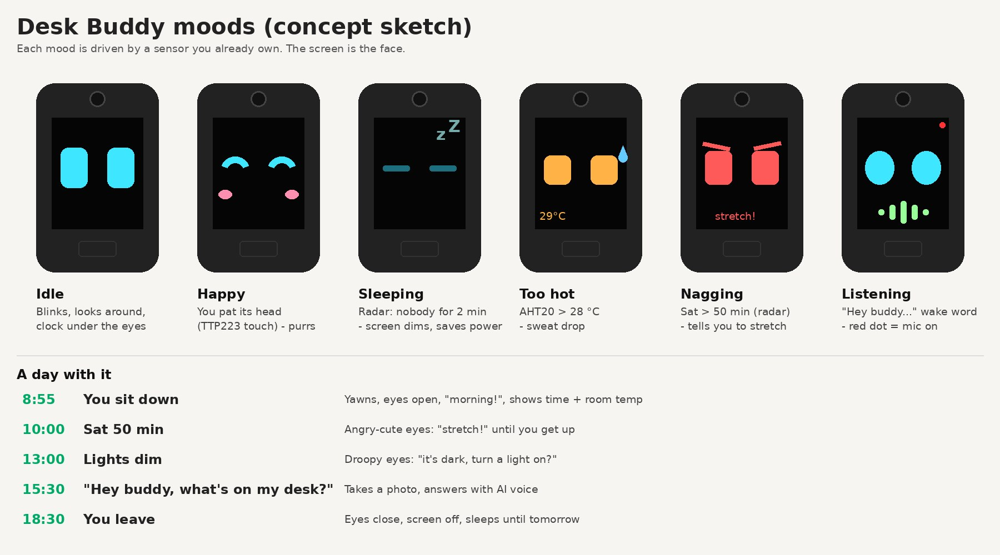

# ESP32-S3 all-in-one desk pet ("Desk Buddy")

A palm-sized desk companion built only from parts you own or have on order: animated eyes on a 2" screen, presence radar, room sensors, head-pat touch, speaker + mic for AI voice chat, and a camera.




## Start here

| # | Doc | What's in it |
|---|---|---|
| 1 | [Research and ideas](docs/01-research-ideas.md) | Similar builds with links, ranked feature list, key findings |
| 2 | [Concept](docs/02-concept.md) | What we're building and why |
| 3 | [Pin map and power](docs/03-pinmap-power.md) | Verified GPIO map, power diagram, power budget, battery life |
| 4 | [Case](docs/04-case.md) | "Pebble": head with a black face on a small stand. OpenSCAD model, STLs, renders, print settings |
| 5 | [Assembly and bring-up](docs/05-assembly-bringup.md) | Steps from breadboard to finished robot |
| 6 | [Firmware plan](docs/06-firmware-plan.md) | Bring-up → pet moods → XiaoZhi AI voice |
| 7 | [Buy list](docs/07-buy-list.md) | ~$35 of missing parts, IP5306 charger first |
| 8 | [Wiring and build guide](docs/08-wiring-build-guide.md) | Colour wiring diagram + step-by-step pictures with a test after each module |

## Folder layout

```
case/pebble_case.scad    Pebble case (OpenSCAD) <- build this one
case/stl/pebble/         head, face (black), headlid, stand, standlid, post, facetest, snaptest
case/render/             Blender script for photo renders of the real STLs
case/robot_case.scad     older robot design, kept for reference (stl/robot/)
case/deskpet_case.scad   first "tower" design, kept for reference (stl/*.stl)
case/img/                renders
firmware/bringup/        PlatformIO test firmware, pins.h = pin map source of truth
docs/                    the plan
```

## The 5 things that matter most
1. **Use the S3 N16R8 CAM board** (in transit) as the main board: it powers the OV5640 properly.
2. **Buy an IP5306 Type-C module.** Your 5 V boost boards can't charge the LiPo.
3. **Never use GPIO35-37** (PSRAM) **or GPIO45** (boot strap). The map uses every other free pin.
4. **Measure your display and board**, update `MEASURE` values, print `pebble_snaptest.stl`, then the face plate and `pebble_facetest.stl`, before the full head.
5. **Check LiPo plug polarity** with a meter before connecting it to anything.
