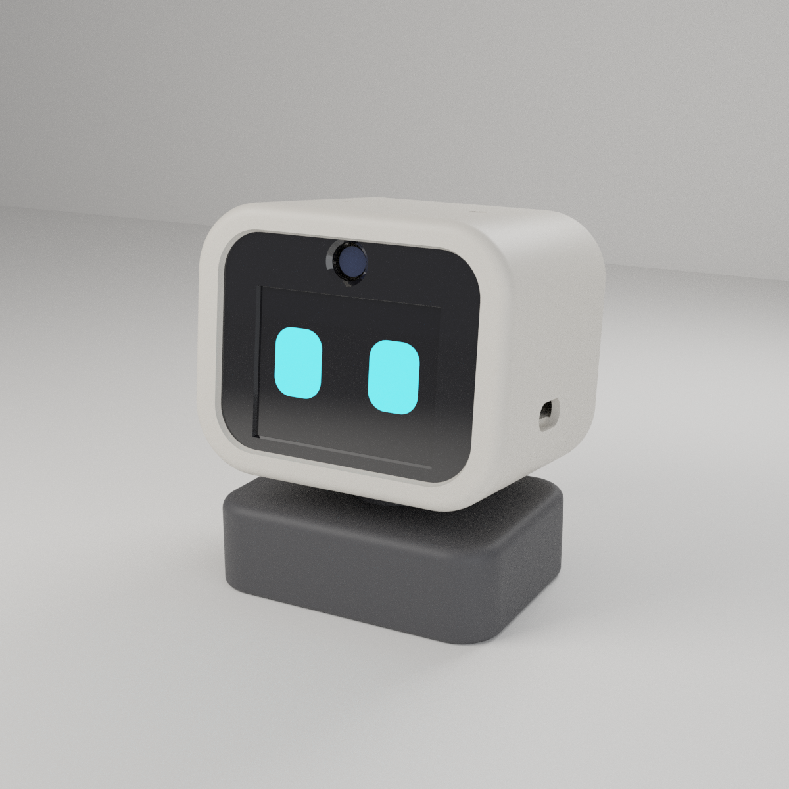

# 4. 3D-printed case: "Pebble"

Model: [`case/pebble_case.scad`](../case/pebble_case.scad) (OpenSCAD, parametric). Ready STLs: [`case/stl/pebble/`](../case/stl/pebble/). Photo renders of the real STLs: [`case/img/`](../case/img/) (made with Blender, script in [`case/render/`](../case/render/)).



Older designs are kept for reference only: the robot (`robot_case.scad`) and the tower (`deskpet_case.scad`).

## Why it looks like this

The design follows what the best-rated desk robots have in common (Emo, Doly, Stack-chan, Rabbit r1):

1. **Black glass face.** The face plate is printed in black, so the display's black border disappears and the eyes seem to float.
2. **Big head on a small, dark stand.** This is the "cute" proportion.
3. **One soft shape.** It has big round corners, no add-on parts, and no screws on the front, top or sides.
4. **One main colour plus black.**

## Shape and layout

**Head 78 × 58 × 62 mm** on a **stand 72 × 54 × 22 mm**. The head is tilted back 6° so it looks up at you, and the robot is about 90 mm tall.

```
        side view                         what is where
   ┌─────────────┐  top: mic hole, light window, head-pat pad (inside)
  ╱│ face  ESP32 │  HEAD   face plate + display + camera (front module)
 ╱ │ plate  board│ speaker  ESP32 board flat on 2 rails, USB-C on the right side
│  │       ~~~~  │  + amp   speaker + amp on the back lid, grille on the back
│  └──────┬┬─────┘          back lid: 4 x M2 screws (back only)
│     neck ││ tilted 6°
 ┌────────┴┴───────┐ STAND  battery on the bottom lid, charger on top of it
 │radar  battery   │        radar behind a 1 mm "chest" window at the front
 └─────────────────┘        temp + pressure sensors at the front, vents underneath
                            back: charger USB-C, LED slot, power button
                            bottom lid: 4 x M2 screws (hidden under the feet side)
```

| Part | Where | Why |
|---|---|---|
| Display 2.0" | Face plate, glass 1.2 mm behind a bevelled window | Its black border blends into the black plate |
| Camera OV5640 | Face plate, above the eyes, in its own pocket | Looks like a phone camera hidden in the black glass |
| ESP32-S3 CAM board | Head, flat on 2 rails 14 mm above the floor | Neck wires run under it; USB-C on the right side for flashing |
| Speaker + MAX98357A | On the head back lid, grille in the lid | Sound goes out the back and bounces off the wall/desk; no holes on the front |
| INMP441 mic | Under the top, 2 mm hole | Away from the speaker |
| BH1750 | Under the top, 4 mm window | Sees room light |
| TTP223 | Glued under the middle of the top | Pat the head |
| Battery 65 × 36 × 10 | Stand, in a cradle on the bottom lid | 1.5 mm spare each side; keeps the weight low |
| IP5306 charger | On top of the battery, USB-C out the back | Charge port at the back |
| LD2410C radar | Stand front, slides into rails, 1 mm chest window | mmWave passes through thin PETG |
| AHT20 / BMP280 | Stand front wall, vents in the bottom lid | Away from the ESP32 heat in the head |

**Fit check done in the model:** `PART="clash"` checks every part against every printed piece (12 pairs, `CI=0..11` shows one pair). Nothing overlaps; parts only rest on their ledges. The tilted head clears the stand by 2.5 mm at the back.

## What to measure before printing (calipers, 5 minutes)

All marked `MEASURE` at the top of `pebble_case.scad`:

1. **Display:** module PCB size (`LCD_PCB`), thickness with glass (`LCD_T`), visible glass area (`LCD_WIN`).
2. **ESP32 CAM board:** length and width (`ESP`) and the USB-C height (`USB_Z`).
3. **Camera:** lens diameter and body size (`CAM_LENS`, `CAM_BODY`).
4. **IP5306 module** (when it arrives): size (`IPM`) and USB-C height (`IPM_USB_Z`).
5. **Battery and speaker:** confirm 65 × 36 × 10 and 35 × 25 × 6.5.

Then print **`pebble_face.stl`** and **`pebble_facetest.stl`** first (the face plate and the first 6 mm of the head, about 1 h together). Check the display, camera and the plate fit. Fix the numbers, re-export, then print the rest.

## Parts to print

| Part | File | Colour | Orientation (as exported) | Time | Filament |
|---|---|---|---|---|---|
| Face plate | `pebble_face.stl` | **black** | front face down, on a **smooth** bed | 40 min | 8 g |
| Face test | `pebble_facetest.stl` | main | face down | 30 min | 10 g |
| Head | `pebble_head.stl` | main | face down | 5 h | 70 g |
| Head back lid | `pebble_headlid.stl` | main | outside down | 40 min | 12 g |
| Stand | `pebble_stand.stl` | dark | **top down** | 2.5 h | 35 g |
| Stand bottom lid | `pebble_standlid.stl` | dark | flat | 40 min | 10 g |
| Neck post | `pebble_post.stl` | dark | flange down | 15 min | 3 g |

About 150 g in total. **No supports**: the bosses have cones under them and the ESP32 rails start with a 45° slope.

**Glossy black face tip:** print the face plate on a smooth PEI sheet or glass, with a 100% concentric top/bottom pattern and ironing off. The side touching the bed comes out shiny like glass. Textured PEI gives a matte face instead.

**Colour ideas:** cream + black (renders), signal orange + black, or all black with a light grey stand.

## Fits you may need to tune

- **Face plate in the head:** 0.3 mm clearance. Hold it with 4 dots of hot glue on the back corners.
- **Head on the neck:** `NECK_FIT = 0.4` (socket is 0.4 mm bigger than the post). The head can turn a little by hand. For tighter, use 0.2.
- **Neck post in the stand:** glue the flange under the stand top (CA glue or epoxy). Line it up so the tube leans to the **back**.

## Exporting STLs

```bash
cd esp32-all-in-one/case
for P in head face headlid stand standlid post facetest; do
  openscad -D "PART=\"$P\"" -o stl/pebble/pebble_$P.stl pebble_case.scad
done
```

Views: `PART="assembly"`, `"exploded"`, `"cutaway"`, `"clash"` (must be empty).

Photo renders (optional, needs Blender 4): export `PART="w_head"`, `w_face`, `w_headlid`, `w_stand`, `w_standlid`, `w_post`, `w_glass` into one folder, then
`blender -b -P render/pebble_render.py -- <that folder> out.png hero cream normal`. Views: hero, front, side, back, exploded. Colours: cream, orange, sage, black. Eyes: normal, happy, sleepy.

## Print settings (PETG, 0.4 mm nozzle)

| Setting | Value |
|---|---|
| Layer height | 0.16 mm for the head (smoother curves), 0.2 mm for the rest |
| Walls | 5 perimeters (= 2 mm wall), 4 top / 4 bottom layers |
| Infill | 20% gyroid |
| Nozzle / bed | 235 to 245 °C / 75 to 80 °C |
| Part cooling fan | 30 to 50% |
| Speed | 40 mm/s outer wall, 60 to 80 mm/s inner |
| Seam | Rear / aligned (hides it on the back) |
| Supports | **None** |

## Fasteners

- 8 × M2 × 6 self-tapping screws: 4 for the head back lid, 4 for the stand bottom lid. Pilot holes are 1.8 mm.
- 4 small rubber feet (8 mm) in the recesses under the stand.
- No screws yet? Hot glue dots hold both lids for testing.
