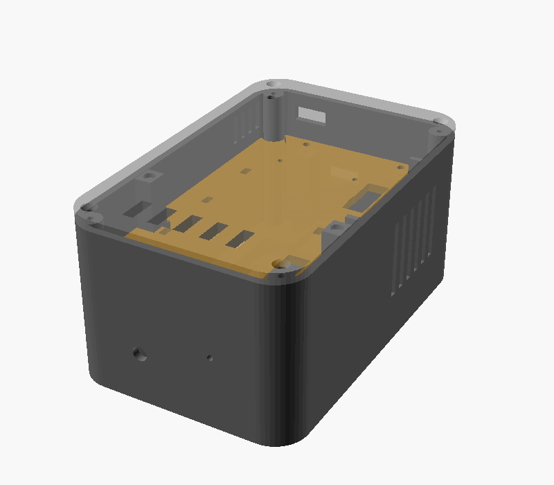

# 4. 3D-printed case

Model: [`case/deskpet_case.scad`](../case/deskpet_case.scad) (OpenSCAD, fully parametric). Ready STLs: [`case/stl/`](../case/stl/). Preview: [`case/img/`](../case/img/).



## Shape and layout

A rounded "tower" pet, **62 W × 96 H × 47 D mm**, sitting in a small stand that tilts it back 10°.

```
 front view                     side section (front on the left)
 ┌───────────────┐              face  display   sled+ESP32   battery  lid
 │      (o)      │ camera        │ ▌▌         │ ▐█████▌     │ ████   │
 │ ┌───────────┐ │               │ ▌▌ wires   │ ▐ ESP32 ▌   │ LiPo   │
 │ │           │ │               │ ▌▌         │ ▐█████▌     │ ████   │
 │ │  display  │ │ eyes          │ 2   2-8    8-23  23-30  34-44     44-47 mm
 │ │           │ │
 │ └───────────┘ │  speaker grille on the left side, mic + light window on top,
 │   [ radar ]   │  temp vents low on the right side, USB-C x2 in the bottom
 └───────────────┘
```

| Part | Where | Why |
|---|---|---|
| Display | Front, 0.8 mm recessed glass, frame behind | Window = active area, so the bezel hides the panel edge |
| Camera | Front "forehead", cone window | 120° lens needs the cone or the case shows in the picture |
| LD2410C | Front "chin", face thinned to 1.0 mm there | mmWave passes through PETG; keep it unobstructed |
| Speaker 2535 | Left wall, firing out of a grille, held by two ribs | Far from the radar and mic |
| Mic | Top wall, 1.6 mm hole | Away from the speaker to reduce echo |
| BH1750 | Top wall, 4 mm window | Sees room light, not the screen glow |
| AHT20+BMP280 | Low on the right wall by its own vents | Coolest spot, away from the ESP32 |
| ESP32 board | On the sled, zip-tied (or M2 screws if it has holes), USB-C down | Flash through the bottom slot |
| IP5306 charger | Bottom right, against the lid, USB-C down | Charge port in the bottom; its LED shows through the lid |
| Battery 36×65×10 | Against the lid, in rib cradle | Biggest part, sits flat at the back |

**Fit check done in the model:** battery (36×65×10) clears the corner bosses and the sled posts; the ESP32 board (28.5×65) fits between the speaker and the right wall; the display frame, radar frame and camera holder don't overlap; the two USB openings are 10 mm apart.

## What to measure before printing (calipers, 5 minutes)

All marked `MEASURE` at the top of the `.scad` file:

1. Display: active area, glass outline, module PCB size, total thickness. And pick `DISPLAY = "2.01"` or `"1.69"`.
2. ESP32 board width and length, and whether it has mounting holes (set `esp_holes = []` if not).
3. IP5306 module size and where its USB-C sits.
4. Speaker: 2535 is 25 × 35 mm, check its depth.
5. Battery: confirm 36 × 65 × 10 (they swell slightly; leave the 0.3 mm clearance).

Then print the **`facetest.stl`** first (the first 7 mm of the shell, ~30 min). Drop the display, camera and radar in. Fix numbers, re-export, then print the full set.

## Exporting STLs

Install OpenSCAD (free), open the `.scad` file, change `PART` and press F6, then File → Export STL. Or from a terminal:

```bash
cd esp32-all-in-one/case
for P in shell sled lid stand facetest; do openscad -D "PART=\"$P\"" -o stl/$P.stl deskpet_case.scad; done
```

## Print settings (matte black PETG, 0.4 mm nozzle)

| Setting | Value |
|---|---|
| Layer height | 0.2 mm (0.16 mm for the shell if you want a smoother face) |
| Walls | 5 perimeters (= the 2 mm wall), 4 top / 4 bottom layers |
| Infill | 20% gyroid |
| Nozzle / bed | 235 to 245 °C / 75 to 80 °C |
| Part cooling fan | 30 to 50% (more makes PETG layers weak) |
| Speed | 40 mm/s outer wall, 60 to 80 mm/s inner |
| Retraction | Tune for stringing (PETG strings); dry the filament if it pops |
| Bed | Textured PEI is ideal: the front face gets a nice matte texture. On smooth PEI use glue stick as a release layer (PETG can rip chunks out of it) |
| Supports | **None needed** |
| Seam | Rear / aligned |

| Part | Orientation | Rough time | Filament |
|---|---|---|---|
| facetest | face down | 30 min | 12 g |
| shell | face down (as exported) | 3.5 h | 55 g |
| sled | flat (as exported) | 40 min | 10 g |
| lid | outside face down (as exported) | 1 h | 15 g |
| stand | flat | 30 min | 10 g |

Total ~90 g, so a 1 kg spool makes many revisions.

## Fasteners

- **Now, without buying anything:** the lid has two magnet pockets (3 × 1 mm magnets you own, glue them in with your magnetic glue, check polarity before the glue sets). Good enough to hold the lid closed.
- **Proper:** 4 × M2 × 8 self-tapping screws for the lid corners, 4 × M2 × 6 for the sled, 4 × M2 × 5 for the board if it has holes. Pilot holes are 1.7 mm for PETG.

## Ideas for v2
- Clear PETG back lid (see-through look, like the exposed-hardware build in the research).
- Ears or antenna on top printed in a second color, glued in.
- Shrink depth to ~38 mm by laying the board and battery side by side once everything is proven.
