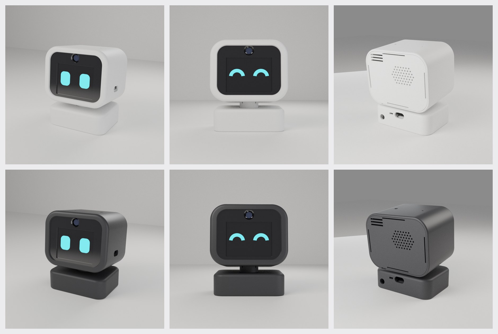

# 4. 3D-printed case: "Pebble"

Model: [`case/pebble_case.scad`](../case/pebble_case.scad) (OpenSCAD, parametric). Ready STLs: [`case/stl/pebble/`](../case/stl/pebble/). Photo renders of the real STLs: [`case/img/`](../case/img/) (made with Blender, script in [`case/render/`](../case/render/)).


**Everything clicks together like Lego: no glue, no screws.** All-white (black face plate) and all-black:



Older designs are kept for reference only: the robot (`robot_case.scad`) and the tower (`deskpet_case.scad`).

## Why it looks like this

The design follows what the best-rated desk robots have in common (Emo, Doly, Stack-chan, Rabbit r1):

1. **Black glass face.** The face plate is printed in black, so the display's black border disappears and the eyes seem to float.
2. **Big head on a small, dark stand.** This is the "cute" proportion.
3. **One soft shape.** It has big round corners, no add-on parts, and no screws anywhere.
4. **One main colour plus black.**

## Shape and layout

**Head 78 × 58 × 62 mm** on a **stand 72 × 54 × 22 mm**. The head is tilted back 6° so it looks up at you, and the robot is about 90 mm tall.

```
        side view                         what is where
   ┌─────────────┐  top: mic hole, light window, head-pat pad (inside)
  ╱│ face  ESP32 │  HEAD   face plate + display + camera (front module)
 ╱ │ plate  board│ speaker  ESP32 board on 2 rails (clip + lips), USB-C on the right
│  │       ~~~~  │  + amp   speaker + amp on the back lid, grille on the back
│  └──────┬┬─────┘          back lid: snaps in (4 clicking edges)
│     neck ││ tilted 6°
 ┌────────┴┴───────┐ STAND  battery on the bottom lid, charger on top of it
 │radar  battery   │        radar behind a 1 mm "chest" window at the front
 └─────────────────┘        temp + pressure sensors at the front, vents underneath
                            back: charger USB-C + LED slot + touch key spot (battery build only, empty in the USB build)
                            bottom lid: 2 front tabs + 3 clicking edges
```

| Part | Where | Why |
|---|---|---|
| Display 2.0" | Face plate, glass 1.2 mm behind a bevelled window | Its black border blends into the black plate |
| Camera OV5640 | Face plate, above the eyes, press-fit pocket | Looks like a phone camera hidden in the black glass |
| ESP32-S3 CAM board | Head, on 2 rails 14 mm above the floor: 2 lips on the USB end, a clip on the other | Neck wires run under it; USB-C on the right side for flashing |
| Speaker + MAX98357A | On the head back lid, grille in the lid | Sound goes out the back and bounces off the wall/desk; no holes on the front |
| INMP441 mic | Under the top, 2 mm hole, slides into rails | Away from the speaker |
| BH1750 | Under the top, 4 mm window, slides into rails | Sees room light |
| TTP223 | Under the middle of the top, slides into rails | Pat the head |
| Battery 65 × 36 × 10 | Stand, in a cradle on the bottom lid, ribs above it | 1.5 mm spare each side; keeps the weight low |
| IP5306 charger | On top of the battery, USB-C out the back | **Not fitted in the owned-parts USB build** (battery bay and back USB hole stay empty; power goes into the ESP32 port on the head's right side) |
| LD2410C radar | Stand front, slides into rails, 1 mm chest window | mmWave passes through thin PETG |
| AHT20 / BMP280 | Stand front wall in their own rails, vents in the bottom lid | Away from the ESP32 heat in the head |
| TTP223 power key (battery build only) | Stand back wall in rails, behind a 1.2 mm thin spot with a dimple outside | **Leave empty in the USB build** (plug in = on). If a boost board turns out to charge, a spare TTP223 here taps its KEY pin through the plastic: no button hole |

**Fit check done in the model:** `PART="clash"` with `-D CRUSH=-0.05` checks every part against every printed piece (14 pairs, `CI=0..13` shows one pair, including the neck post's path when it is pushed in and turned). Nothing overlaps; parts only rest on their ledges. The only touch is the detent the neck pawl clicks past, on purpose. The tilted head clears the stand by 2.5 mm at the back.

## How it snaps together (no glue, no screws)

| Joint | How | Open it |
|---|---|---|
| Head back lid | 4 flexing beams on the lid edges (printed flat, so they bend along the layers), bumps click into grooves in the head | Coin in the notch under the head, bottom right |
| Stand bottom lid | 2 front tabs hook into the front wall, then 3 beams click (left, right, back) | Coin in the notch under the back edge |
| Face plate | 4 arms on its back hook behind 4 catches inside the head | Back lid off, press the arms in |
| Neck post in stand | Twist lock: push it up turned 45°, turn until a pawl clicks. Ears sit under 2 hooks; it can only lock leaning back | Turn it back hard |
| Head on neck | 4-finger collet with a bead that clicks into a groove. The head still turns by hand | Pull the head up |
| Display, camera, speaker | Press-fit pockets with crush ribs (0.15 mm) | Pull out |
| ESP32 board | USB end under 2 lips, other end clicks under a long clip arm | Push the clip arm out |
| Mic, BH1750, TTP223 | Slide into rails under the top from the back, stop at the front | Slide out |
| Radar, AHT20, BMP280 (and the optional power key) | Slide into rails on the stand front/back wall; the lid holds them up | Lid off, slide down |
| Battery, IP5306 | Cradle on the lid; ribs under the stand top keep them from lifting | Lid off |
| Amp | Slides into 2 rails on the back lid until it stops | Slide out |

Strain on every flexing part is 0.6 to 2 %, well inside PETG's safe range, so they survive many open/close cycles. **Works in one colour:** all parts are plain PETG, any colour. If you print white, print the face plate in black if you can (swap the spool for that one 40 min print), because a white face shows the display's black border. All-black needs no swap.

## What to measure before printing (calipers, 5 minutes)

All marked `MEASURE` at the top of `pebble_case.scad`:

1. **Display:** module PCB size (`LCD_PCB`), thickness with glass (`LCD_T`), visible glass area (`LCD_WIN`).
2. **ESP32 CAM board:** length and width (`ESP`) and the USB-C height (`USB_Z`).
3. **Camera:** lens diameter and body size (`CAM_LENS`, `CAM_BODY`).
4. **IP5306 module** (when it arrives): size (`IPM`) and USB-C height (`IPM_USB_Z`). Battery build only: the **TTP223 board** for the power key, width and height (`PWR`).
5. **Battery and speaker:** confirm 65 × 36 × 10 and 35 × 25 × 6.5.

Then print **`pebble_snaptest.stl`** first (25 min, 10 g): a piece of the stand top with the neck lock, plus a small frame and lid with the real lid beams. Check the lid clicks on and off, and that the real `pebble_post.stl` twist-locks and clicks. If the lid is too tight, lower `BUMP` by 0.1; too loose, raise it. Then print **`pebble_face.stl`** and **`pebble_facetest.stl`** (the face plate and the first 17 mm of the head with its catches, about 1.2 h). Check the plate clicks in and the display and camera press in. Fix the numbers, re-export, then print the rest.

## Parts to print

| Part | File | Colour | Orientation (as exported) | Time | Filament |
|---|---|---|---|---|---|
| Face plate | `pebble_face.stl` | **black** | front face down, on a **smooth** bed | 40 min | 8 g |
| Snap test | `pebble_snaptest.stl` | any | as exported | 25 min | 10 g |
| Face test | `pebble_facetest.stl` | main | face down | 45 min | 20 g |
| Head | `pebble_head.stl` | main | face down | 5 h | 70 g |
| Head back lid | `pebble_headlid.stl` | main | outside down | 40 min | 12 g |
| Stand | `pebble_stand.stl` | dark | **top down** | 2.5 h | 35 g |
| Stand bottom lid | `pebble_standlid.stl` | dark | flat | 40 min | 10 g |
| Neck post | `pebble_post.stl` | dark | flange down | 15 min | 3 g |

About 150 g in total. **No supports**: the lid stops have cones under them, the catches have 45° undersides and the ESP32 rails start with a 45° slope.

**Glossy black face tip:** print the face plate on a smooth PEI sheet or glass, with a 100% concentric top/bottom pattern and ironing off. The side touching the bed comes out shiny like glass. Textured PEI gives a matte face instead.

**Colour ideas:** all black, or all white with a black face plate (renders above), cream + black, signal orange + black.

## Fits you may need to tune

- **Lids:** `BUMP` (grip of the click, default gap + 0.7 mm) and `LID_CLR` (0.2 mm gap). Test with the snap test.
- **Face plate arms:** `HOOK` (1.0 mm). Too hard to push in: 0.8.
- **Display / camera / speaker:** `CRUSH` (0.15 mm per rib). Loose: 0.25. Too tight: 0.1.
- **Head on the neck:** `NECK_FIT = 0.4` and `BEAD = 0.3`. For a firmer click, `BEAD = 0.4`.

## Exporting STLs

```bash
cd esp32-all-in-one/case
for P in head face headlid stand standlid post facetest snaptest; do
  openscad -D "PART=\"$P\"" -o stl/pebble/pebble_$P.stl pebble_case.scad
done
```

Views: `PART="assembly"`, `"exploded"`, `"cutaway"`, `"clash"` (run with `-D CRUSH=-0.05`; must be empty or thin contacts only).

Photo renders (optional, needs Blender 4): export `PART="w_head"`, `w_face`, `w_headlid`, `w_stand`, `w_standlid`, `w_post`, `w_glass` into one folder, then
`blender -b -P render/pebble_render.py -- <that folder> out.png hero cream normal`. Views: hero, front, side, back, exploded. Colours: cream, orange, sage, black, allblack, white. Eyes: normal, happy, sleepy.

## Print settings (PETG, 0.4 mm nozzle)

| Setting | Value |
|---|---|
| Layer height | 0.16 mm for the head (smoother curves), 0.2 mm for the rest |
| Walls | 5 perimeters (= 2 mm wall), 4 top / 4 bottom layers |
| Infill | 20% gyroid |
| Nozzle / bed | 235 to 245 °C / 75 to 80 °C |
| Part cooling fan | 30 to 50% |
| Speed | 40 mm/s outer wall, 60 to 80 mm/s inner |
| Seam | Rear / aligned (hides it on the back) |
| Supports | **None** |

## Fasteners

- None. No screws, no glue, no magnets, no rubber feet. Only parts you already own.
- Want more grip on the desk? A few dots of anything rubbery (or a strip of the foam tape) under the lid. Optional.
