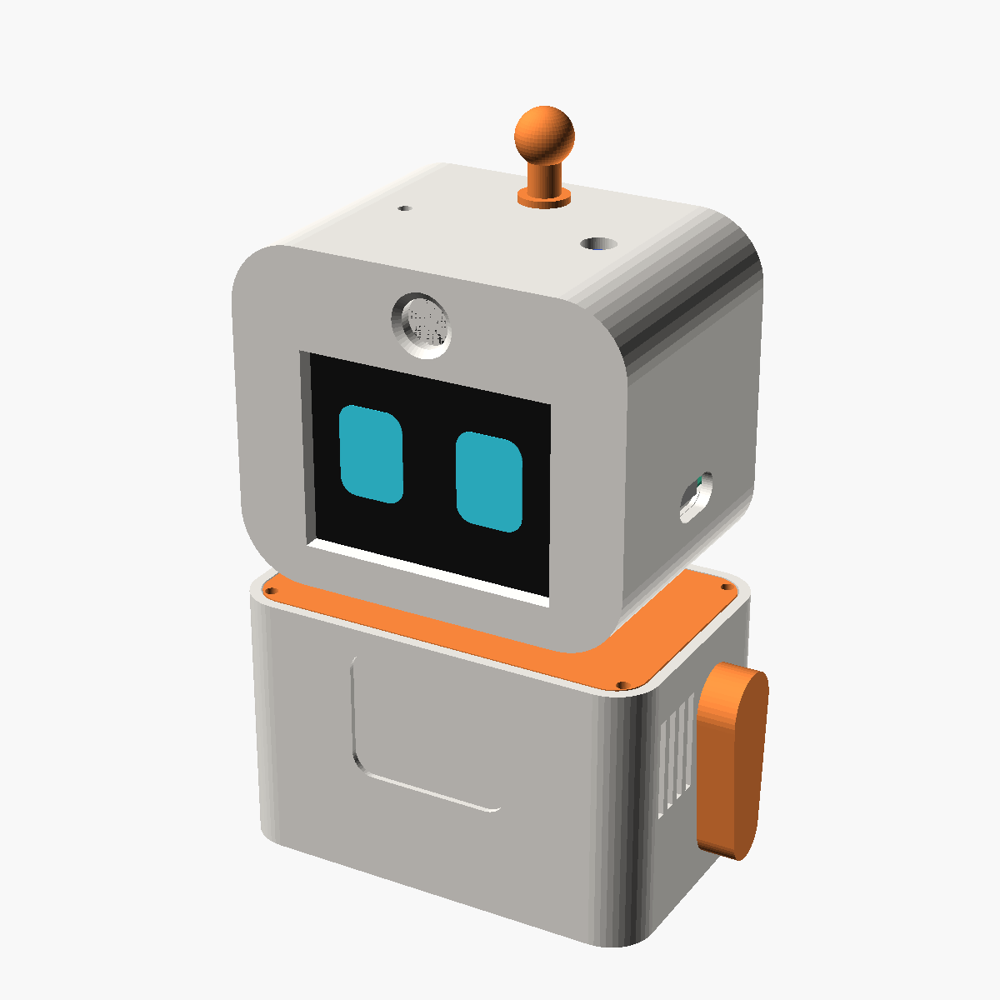
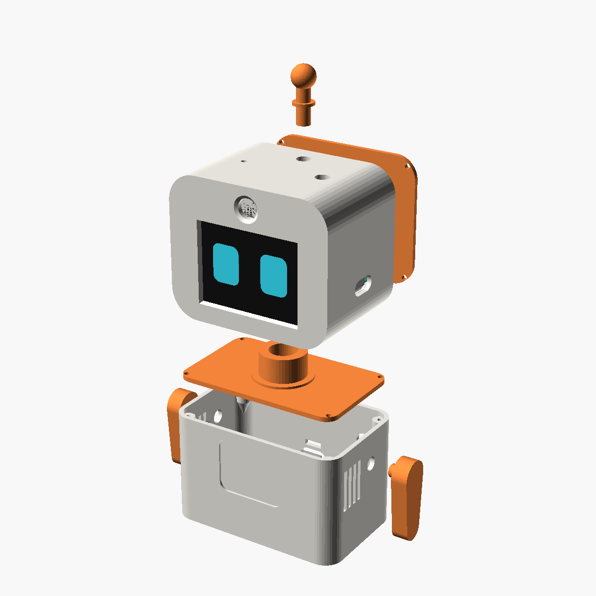

# 4. 3D-printed case: robot (head + body)

Model: [`case/robot_case.scad`](../case/robot_case.scad) (OpenSCAD, parametric). Ready STLs: [`case/stl/robot/`](../case/stl/robot/). Renders: [`case/img/`](../case/img/).

 

The first "tower" design is still in `case/deskpet_case.scad` and `case/stl/*.stl`, but the robot is the one to build.

## Shape and layout

A small robot, **78 W × 50 D × about 124 H mm** with the antenna. The head turns on the neck by hand.

```
          (o)  antenna (push-fit)
    ┌──────────────┐  HEAD 72 x 50 x 60
    │     (cam)    │  top: mic hole, light window, head-pat pad under the top
    │ ┌──────────┐ │  left side: speaker grille      right side: ESP32 USB-C
  spk │  display │ │  inside: ESP32 board flat on 2 rails, behind the display
    │ └──────────┘ │  back: screw-on lid (4 x M2)
    └─────┬──┬─────┘
          │  │  neck tube, 8 wires inside, head turns on it
  ┌───────┴──┴───────┐  BODY 78 x 50 x 48
 ═╡   ┌────────┐     ╞═ arms (push-fit pegs, they swing)
  │   │ radar  │     │  front: thin "chest panel", the radar looks through it
  │   └────────┘     │  sides: vents for AHT20 (right) and BMP280 (left)
  │ ██ battery ██    │  back: charger USB-C, LED slot, power button
  └──────────────────┘  top: lid with the neck tube (4 x M2)
```

| Part | Where | Why |
|---|---|---|
| Display 2.0" | Head front, bevelled window, pocket frame behind | Frame is open at the bottom for the flex cable |
| Camera OV5640 | Head "forehead", lens hole with a cone | Ribbon runs down to the ESP32 board right behind it |
| ESP32-S3 CAM board | Head, lying flat on 2 side rails, 14 mm above the floor | Wires from the neck come up under it; USB-C on the right side |
| Speaker 35×25 | Head left wall behind a grille, held by the back lid | Far from the mic |
| INMP441 mic | Under the top, 2.5 mm hole | Away from the speaker |
| BH1750 | Under the top, 6 mm window | Sees room light |
| TTP223 | Glued under the middle of the top wall | Head-pat sensor works through 2 mm plastic |
| Battery 65×36×10 | Body floor, between stop ribs | Low weight keeps the robot from tipping |
| IP5306 charger | Body, on foam tape on top of the battery, USB-C out the back | Charge port at the back |
| LD2410C radar | Body front, slides into rails behind a 1 mm chest panel | mmWave goes through thin PETG |
| AHT20 / BMP280 | Body side walls, behind the vents | Away from the ESP32 heat (it's in the head) |

**Fit check done in the model:** a `clash` view intersects every part with the printed pieces, and it comes out empty (parts only touch the ledges they sit on). All internal ribs are trimmed to the rounded outside. Total height with the antenna is 124 mm.

## What to measure before printing (calipers, 5 minutes)

All marked `MEASURE` at the top of `robot_case.scad`:

1. **Display:** module PCB size (`LCD_PCB`), thickness with glass (`LCD_T`), visible glass area (`LCD_WIN`).
2. **ESP32 CAM board:** length and width (`ESP`) and where its USB-C sits (`USB_Z`). If your board has two USB-C ports, tell me and I'll add a second hole.
3. **Camera:** lens diameter and square body size (`CAM_LENS`, `CAM_BODY`).
4. **IP5306 module** (when it arrives): size and USB-C height (`IPM`, `IPM_USB_Z`).
5. **Battery and speaker:** confirm 65 × 36 × 10 and 35 × 25 × 6.5.

Then print **`robot_facetest.stl`** first: the first 8 mm of the head's face (about 40 min). Drop the display and camera in. Fix the numbers, re-export, then print the rest.

## Parts to print

| Part | File | Orientation (as exported) | Rough time | Filament |
|---|---|---|---|---|
| Face test | `robot_facetest.stl` | face down | 40 min | 12 g |
| Head | `robot_head.stl` | **face down** on the bed | 4 h | 60 g |
| Head back lid | `robot_headlid.stl` | flat | 30 min | 9 g |
| Body | `robot_body.stl` | floor down | 4 h | 60 g |
| Body lid + neck | `robot_bodylid.stl` | flat, neck tube up | 1 h | 14 g |
| Arm | `robot_arm.stl` | flat, peg up. **Print 2** | 20 min each | 3 g each |
| Antenna | `robot_antenna.stl` | upright, use a brim | 15 min | 1 g |

Total about 165 g. No supports needed: the screw bosses have cones under them and the ESP32 rails start at the face wall, so everything builds up from the bed.

Two-colour look (like the renders): head and body in white or light grey, lids, arms and antenna in orange. Any colour works.

## Fits you may need to tune

- **Head turning on the neck:** `NECK_FIT = 0.4` (socket is 0.4 mm bigger than the tube). Too loose: 0.2. Too tight: 0.6. A wrap of tape around the tube also works.
- **Arms:** pegs are 5.7 mm in 6 mm holes, so they swing. For fixed arms, add a drop of glue.
- **Antenna:** 5.7 mm stem in a 6 mm hole, 8 mm deep. Glue it if it falls out.

## Exporting STLs

Install OpenSCAD (free), open the `.scad` file, change `PART` and press F6, then File → Export STL. Or from a terminal:

```bash
cd esp32-all-in-one/case
for P in head headlid body bodylid arm antenna facetest; do
  openscad -D "PART=\"$P\"" -o stl/robot/robot_$P.stl robot_case.scad
done
```

Views: `PART="hero"`, `"exploded"`, `"cutaway"` (shows the parts inside), `"clash"` (should be empty).

## Print settings (PETG, 0.4 mm nozzle)

| Setting | Value |
|---|---|
| Layer height | 0.2 mm (0.16 mm for the head for a smoother face) |
| Walls | 5 perimeters (= the 2 mm wall), 4 top / 4 bottom layers |
| Infill | 20% gyroid |
| Nozzle / bed | 235 to 245 °C / 75 to 80 °C |
| Part cooling fan | 30 to 50% |
| Speed | 40 mm/s outer wall, 60 to 80 mm/s inner |
| Bed | Textured PEI gives the face a nice matte look. On smooth PEI use glue stick as a release layer |
| Supports | **None** |
| Seam | Rear / aligned |

## Fasteners

- 8 × M2 × 6 self-tapping screws: 4 for the head back lid, 4 for the body lid. Pilot holes are 1.8 mm.
- No screws yet? A few dots of hot glue on the lid edges hold fine until you have them.
- ESP32 board: sits on the rails between small lips. Add 2 dots of hot glue (or M2 screws if your board has holes).
- 4 small rubber feet go in the recesses under the body (8 mm).

## Ideas for v2
- Clear PETG body lid to show the electronics.
- Neck servo (SG90) so the head can turn by itself to face you when the radar sees you.
- Eyelids or ears printed in a second colour.
