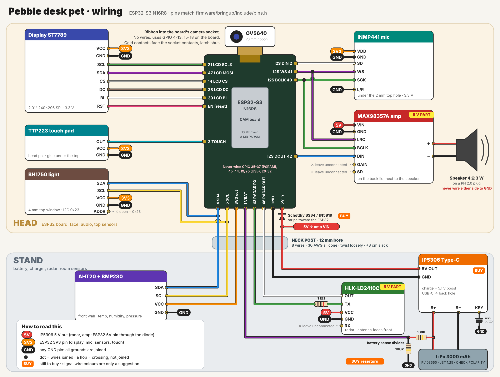
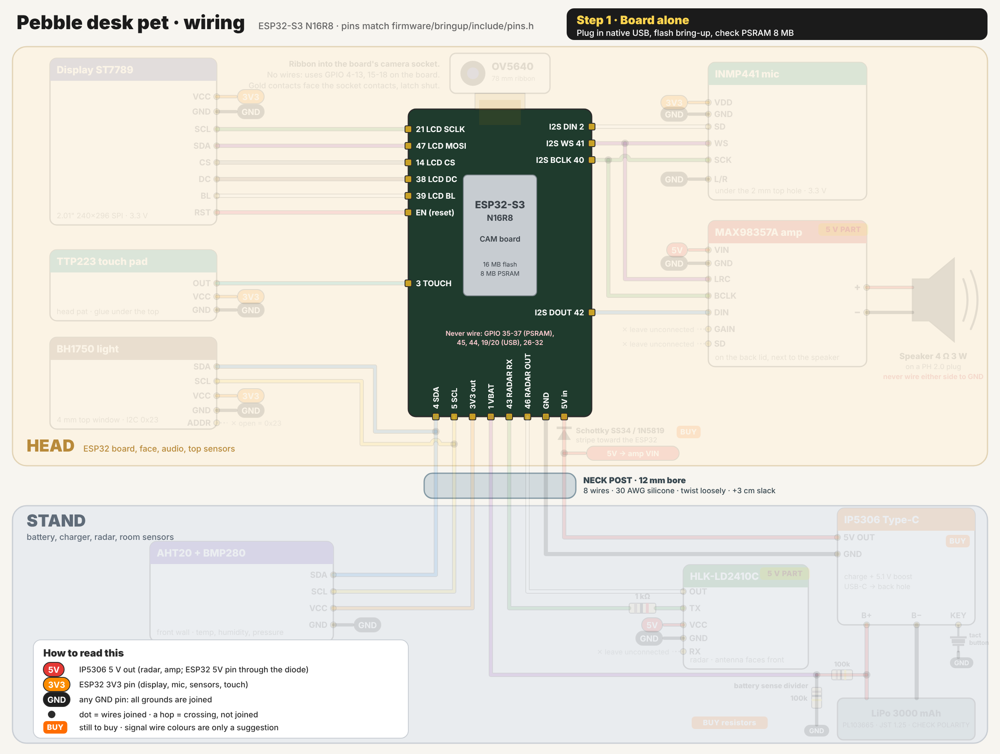
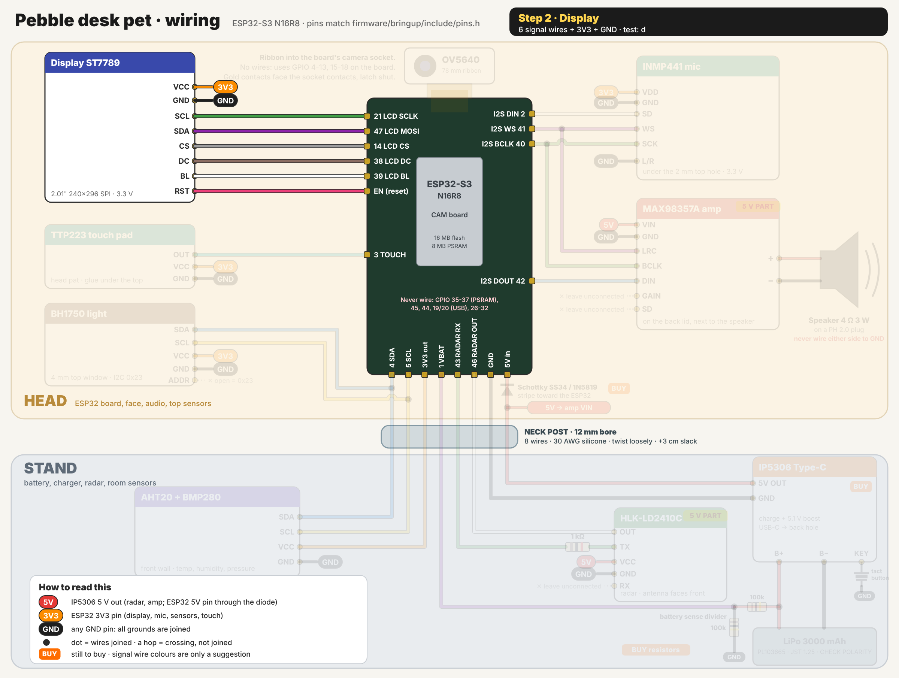
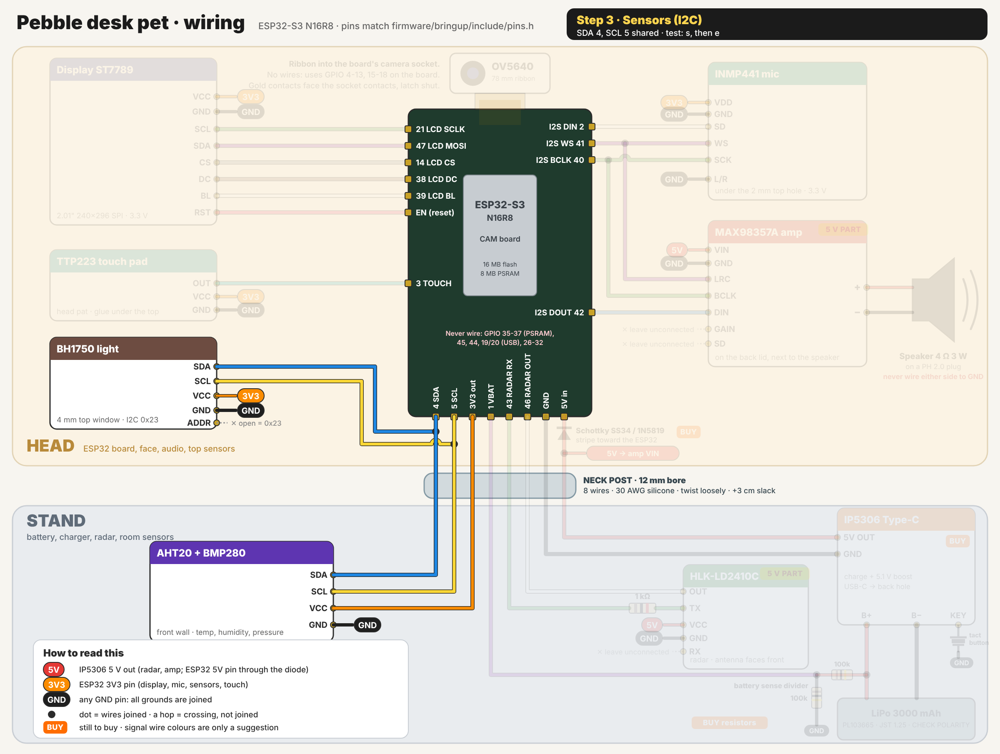
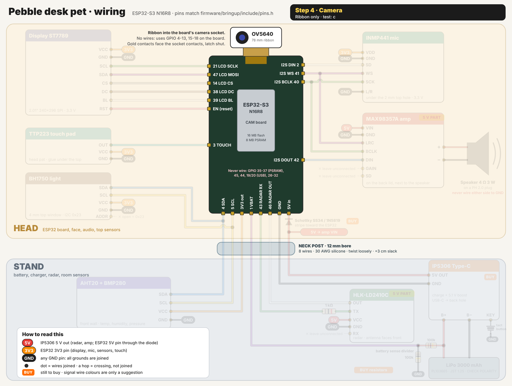
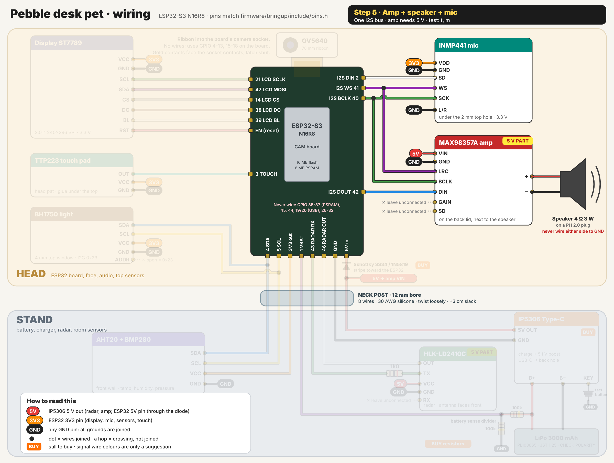
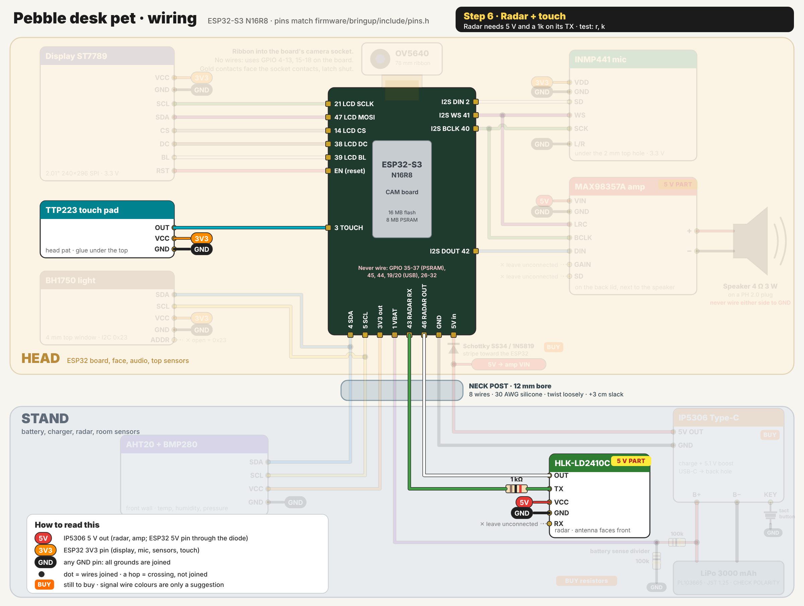
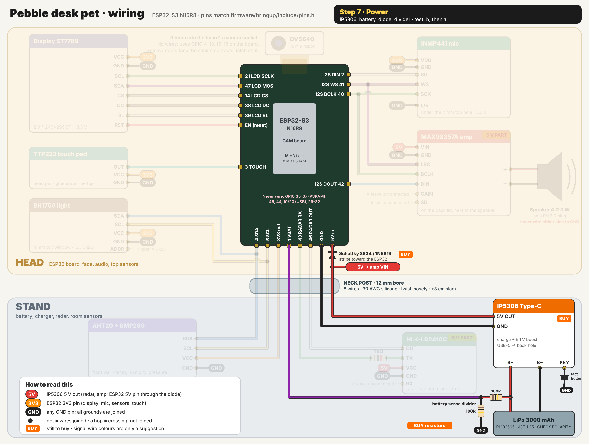
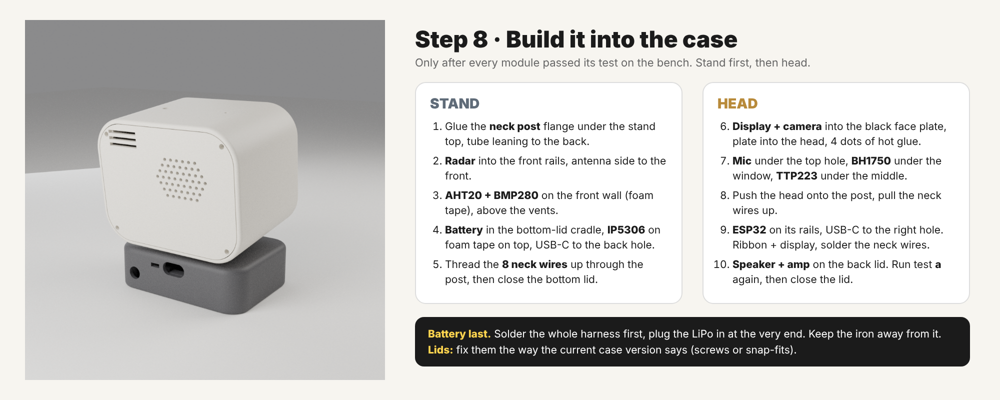

# 8. Wiring and build guide (with pictures)

The picture version of [pin map](03-pinmap-power.md) + [assembly](05-assembly-bringup.md). Pins match [`pins.h`](../firmware/bringup/include/pins.h).

**Rails:** red **5V** = IP5306 output (radar, amp, and the ESP32 5V pin through a diode). Orange **3V3** = the ESP32's 3V3 pin. Black **GND** = all grounds joined.
**The two 5 V parts are the LD2410C radar and the MAX98357A amp.** Everything else is 3.3 V. Never put 5 V on a GPIO.

## Before you start: still to buy

| Needed for | Part |
|---|---|
| Step 7 (power) | **IP5306 Type-C module**, **SS34/1N5819 Schottky**, **6×6 tact button** |
| Steps 6, 7 | **Resistors**: 1k (radar), 2 × 100k (battery sense) |
| Step 8 (harness) | **30 AWG silicone wire**, **M2 screws** (or hot glue for now) |

Steps 1 to 6 work without any of these: use breadboard jumpers and USB power. Full list: [buy list](07-buy-list.md).

## How each step works

1. Wire only the parts in the picture, on a breadboard, with jumper wires.
2. Plug the board in by its **native USB** port and open the serial monitor of the [bring-up firmware](../firmware/bringup) (115200).
3. Type the test letter. Move on only when it passes.

While on USB, take "5V" from the board's **5V pin** (it's the USB 5 V) and "3V3" from its **3V3 pin**. The IP5306 only takes over in step 7.

---

### Step 1 · Board alone

- Upload the bring-up firmware. If upload fails: hold BOOT, tap RST, release BOOT, retry.
- **Pass:** log shows `PSRAM 8388608 bytes, flash 16777216 bytes`.

### Step 2 · Display

- VCC→3V3, GND, SCL→21, SDA→47, CS→14, DC→38, BL→39, RST→EN.
- **Test `d`:** colours cycle, then a yellow frame. All 4 edges visible? If not, change `LCD_OFFSET_Y` in `main.cpp` (0, 12, 20, 24).

### Step 3 · Sensors (I2C)

- AHT20+BMP280 and BH1750 all on the same 4 wires: 3V3, GND, SDA→4, SCL→5. On the bench, wire them straight to the board (no neck yet).
- **Test `s`:** finds `0x23`, `0x38`, `0x77` (or `0x76`). **Test `e`:** readings.

### Step 4 · Camera

- Ribbon only. Gold contacts toward the socket contacts, latch closed. Never plug it in with power on.
- **Pass:** log says `camera OK, sensor PID 0x5640`; `s` now also shows `0x3C`. **Test `c`:** live mirror on the display.

### Step 5 · Amp + speaker + mic

- Amp: **VIN→5V**, GND, BCLK→40, LRC→41, DIN→42. GAIN and SD unconnected. Speaker on + and −, **neither side to GND**.
- Mic: VDD→3V3, GND, L/R→GND, SCK→40, WS→41, SD→2. (Mic and amp share pins 40 and 41.)
- **Test `t`:** three beeps. **Test `m`:** talk, bars jump. Hiss or silence: BCLK/LRC swapped, or no real 5 V on the amp.

### Step 6 · Radar + touch

- Radar: **VCC→5V**, GND, its TX → **1k** → 43, OUT→46. Its RX stays unconnected. No 1k yet? Skip the radar and come back.
- Set the range to ~1.5 m in the **HLKRadarTool** app (Bluetooth).
- Touch: VCC→3V3, GND, OUT→3.
- **Test `r`:** distance values. **Test `k`:** touch the pad.

### Step 7 · Power (careful)

1. **Check the battery plug polarity with a multimeter** before it touches the IP5306. JST 1.25 plugs come wired both ways; reversed = dead charger.
2. Battery to IP5306 B+/B−. Tact button from KEY to GND. Press: 5.0 to 5.2 V on 5V OUT.
3. 5V OUT → radar VCC and amp VIN directly, and → **Schottky (stripe toward the ESP32)** → board 5V pin. GND to GND.
4. Divider: B+ → 100k → GPIO1 → 100k → GND.
5. **Test `b`:** 3.7 to 4.2 V. Unplug the PC, run on battery, **test `a`** (all). Resets on beeps = 5 V sags: add 470 µF across the amp VIN/GND.

Button: 1 press = on, 2 quick presses = off.

### Step 8 · Into the case

**Harness tips**
- 30 AWG silicone, each wire ~2 cm longer than the straight path. Keep the colours: red 5 V, orange 3.3 V (white if your kit has no orange), black GND.
- Solder straight to the ESP32 pins (no headers): the board sits on rails and the wires run underneath.
- The **8 neck wires** (SDA, SCL, 3V3, VBAT, radar TX, radar OUT, GND, 5V): +3 cm slack, twisted loosely. The 1k sits at the radar end, the divider and the Schottky as shown.
- Speaker on a PH 2.0 plug, battery on its JST 1.25, so the lids come off.
- Insulate joints with heat-shrink or Kapton.

Then flash the real firmware ([plan](06-firmware-plan.md)) and use OTA from then on.

---
Images are generated: `python3 img/src/wiring.py <dir> && node img/src/render.js <dir>` (needs Playwright). Edit `wiring.py` if a pin changes, together with `pins.h` and doc 3.
